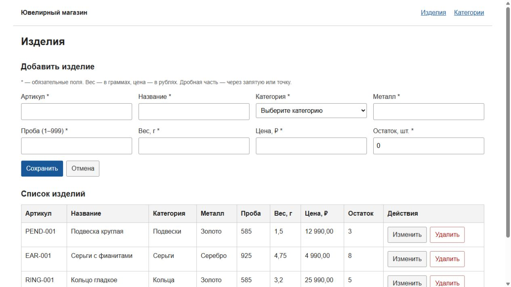

# Лабораторная работа №1 — Jakarta EE

Выполнили:

- Коновалов Павел, группа 6131
- Мартынов Олег, группа 6133

## Задание

Разработать трёхслойное приложение с доступом к базе данных и операциями добавления, редактирования и удаления.
Предметная область — **ювелирный магазин**. Сущности — категория и ювелирное изделие; у категории может быть несколько изделий.

## Реализация

- Сервер приложений — Payara Full, СУБД — PostgreSQL.
- Слой данных — JPA-сущности [Category](src/main/java/ru/ssau/jewelry/model/Category.java) и [Product](src/main/java/ru/ssau/jewelry/model/Product.java).
- Бизнес-слой — сессионный EJB [InventoryService](src/main/java/ru/ssau/jewelry/service/InventoryService.java).
- Представление — Jakarta Faces. Обе сущности поддерживают CRUD; категория с изделиями не удаляется.
- Создание и заполнение базы — [SQL-скрипты](sql/). Сборка WAR и развёртывание выполняются через Docker, без IDE.

## Изделия

Форма добавления и список изделий с категорией, металлом, пробой, весом, ценой и остатком.



«Изменить» открывает изделие в форме, «Удалить» удаляет запись. Управление категориями доступно через верхнее меню.

## Запуск

Из этой папки создайте `.env` по `.env.example`, задайте `POSTGRES_PASSWORD` и выполните:

```shell
docker compose up --build -d --wait --wait-timeout 180
```

Приложение: [localhost:8080/jewelry-shop](http://localhost:8080/jewelry-shop/).
Подробности запуска и проверки: [инструкция](docs/run.md).
