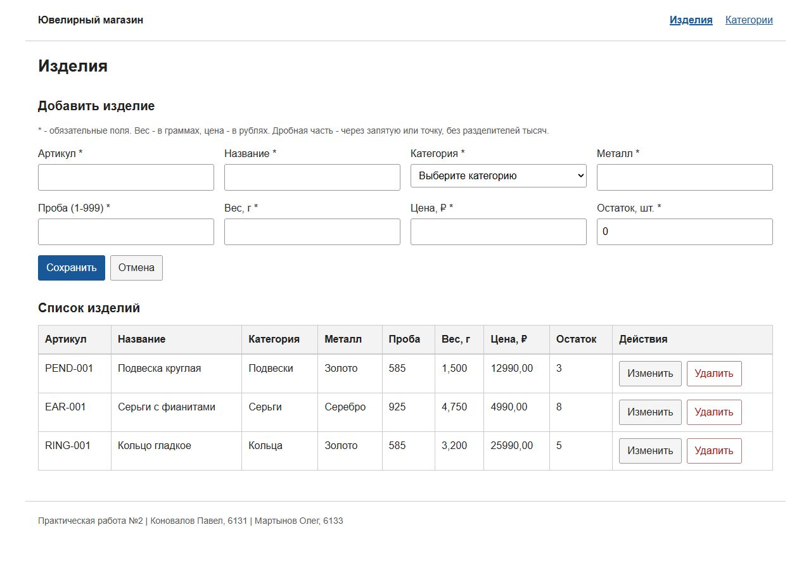

# Лабораторная работа №2 - Spring

Выполнили:

- Коновалов Павел, группа 6131.
- Мартынов Олег, группа 6133.

Приложение для управления категориями и изделиями ювелирного магазина:
просмотр, добавление, редактирование и удаление записей.

## Технологии

- Java 21, Spring Boot 3.5.16.
- Spring MVC и Thymeleaf.
- Spring Data JPA, Hibernate и Jakarta Bean Validation.
- PostgreSQL 17.6.
- Maven и Docker Compose.
- JUnit 5, Mockito и Testcontainers.

## Структура приложения

- Представление - MVC-контроллеры в `web/`, Thymeleaf-шаблоны и DTO.
- Бизнес-логика - `CategoryService` и `ProductService` в `service/`.
- Данные - JPA-сущности в `model/`, репозитории в `repository/`, Hibernate и PostgreSQL.

## Модель данных

| Сущность | Основные свойства |
| --- | --- |
| Category - категория | Название, описание |
| Product - изделие | Артикул, название, металл, проба, вес, цена, остаток, категория |

В категории может быть несколько изделий. Каждое изделие принадлежит одной категории.
SQL-скрипты создания и заполнения БД находятся в [sql/](sql/).

## Запуск

Нужны Docker Engine или Docker Desktop с Linux-контейнерами и Docker Compose.
Для контейнерного запуска локальные Java и Maven не требуются.

Перейдите в каталог практики. Если `.env` ещё нет, скопируйте `.env.example`.
Команды из корня репозитория для PowerShell:

```powershell
cd LR_02_Spring
Copy-Item .env.example .env
```

В Linux/macOS: `cp .env.example .env`.

В `.env` заполните `POSTGRES_PASSWORD`, остальные значения можно оставить:

```dotenv
POSTGRES_DB=jewelry
POSTGRES_USER=jewelry
POSTGRES_PASSWORD=
APP_PORT=8081
```

Файл `.env` исключён из Git. Запустите приложение:

```shell
docker compose up --build -d
docker compose ps
```

Дождитесь статуса `healthy` для обоих сервисов.
Откройте [http://localhost:8081/](http://localhost:8081/).
Разделы: [изделия](http://localhost:8081/products) и [категории](http://localhost:8081/categories).

Просмотр логов, остановка и повторный запуск:

```shell
docker compose logs --tail=100 app
docker compose logs --tail=100 db
docker compose stop
docker compose start
docker compose down
```

Данные хранятся в томе `jewelry-lab2_postgres-data` и сохраняются после `stop` и `down`.
Команда `docker compose down -v` удаляет том вместе с данными.
SQL-скрипты выполняются только при первом запуске с пустым томом;
изменение пароля в `.env` не меняет пароль уже созданной БД.

## Использование

Сначала создайте категорию, затем добавьте изделие, выбрав её в форме.
Кнопка «Изменить» открывает запись для редактирования, «Сохранить» применяет изменения,
«Отмена» сбрасывает несохранённые изменения. Удаление требует подтверждения.
Категорию с изделиями удалить нельзя. Вес и цену можно вводить с запятой или точкой,
без разделителей тысяч.

## Тестирование

Для локальной сборки нужны JDK 21 и Maven. Проверьте версию Java командой `mvn -version`.

```shell
mvn -B -ntp verify
mvn -B -ntp verify -Pintegration
```

Первая команда запускает модульные и MVC-тесты и собирает приложение.
Вторая дополнительно запускает интеграционные тесты с PostgreSQL через Testcontainers
и требует работающий Docker. Для них создаётся отдельная временная БД.

## Скриншот


